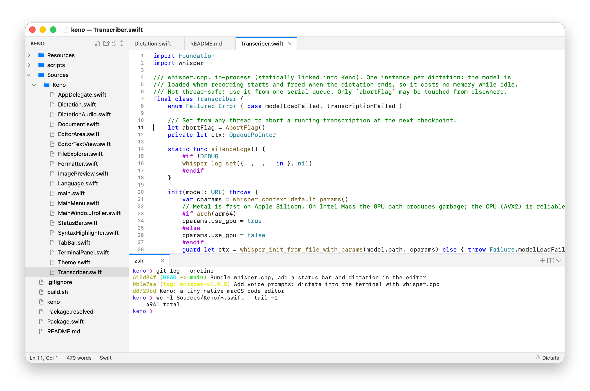

<p align="center">
  
</p>

<h1 align="center">Keno</h1>

<p align="center">
  A tiny, native macOS code editor: file explorer, tabbed editor, tabbed terminal.<br>
  Nothing else. Around 12&nbsp;MB of RAM.
</p>

<p align="center">
  <picture>
    <source media="(prefers-color-scheme: dark)" srcset="docs/screenshot-dark.png">
    
  </picture>
</p>

---

*Keno* comes from the Greek **κενό**: "void, empty space". It keeps the editor layout you use every day (a folder tree on the left, tabs in the middle, terminals at the bottom or side) and drops everything else. It's pure Swift and AppKit: no Electron, no web views, no background services.

## Features

**Explorer**
- Folder tree that loads lazily and stays in sync with the disk (FSEvents)
- Single-click opens a preview tab; double-click keeps it open
- Context menu: new file/folder, rename, move to Trash, reveal in Finder, copy path, open in terminal

**Editor**
- Tabs with unsaved-change indicators, middle-click to close
- Syntax highlighting for Swift, C/C++/Obj-C, JS/TS, Python, Ruby, Go, Rust, Java/Kotlin, C#, PHP, Shell, JSON, YAML, TOML, HTML/XML, CSS, Markdown, SQL, Lua, Dockerfile and Makefile
- Incremental lexer: a keystroke re-lexes only until line states converge, and only visible lines are painted
- Line numbers, auto-indent, soft tabs, indent/outdent, toggle line comment, word wrap
- Find & replace bar
- **Format Document** using the formatter you already have installed (swift-format, prettier, ruff/black, gofmt, rustfmt, clang-format, shfmt, jq, xmllint, …)
- Image preview (PNG, JPEG, GIF, HEIC, WebP, AVIF, TIFF, …), decoded only at on-screen resolution
- Reloads files changed on disk when they have no unsaved edits

**Terminal**
- Multiple terminal tabs running your login shell, powered by [SwiftTerm](https://github.com/migueldeicaza/SwiftTerm)
- Panel can sit below or beside the editor
- Option stays Option, so international keyboard layouts can type `@ { } [ ] | \ ~`

**Dictation**
- Press ⌥⌘R (or **Dictate** in the status bar), speak, press again. Text goes wherever your cursor is:
  - **Editor**: it appears as you talk, so you can dictate long notes, drafts or instructions (up to an hour). A long pause after a sentence starts a new paragraph.
  - **Terminal**: one paste when you stop, ready to review before you hit Enter. Handy for prompts to AI coding tools.
- Transcribed on your Mac by the built-in [whisper.cpp](https://github.com/ggml-org/whisper.cpp): nothing to install, free and offline. Audio stays in memory and is never written to disk, and nothing is loaded until you start.
- Speech is transcribed in pieces while you talk, so even long dictations are done a few seconds after you stop.

**General**
- Status bar: line and column, word count of the file or selection (click to switch to characters or reading time), language; image size for images
- Remembers open tabs per folder, recent folders and layout
- Follows light/dark mode; one shared zoom level for the editor and terminal
- Multiple windows

## Keyboard shortcuts

| Action | Shortcut |
|---|---|
| Open file or folder | ⌘O |
| Open folder | ⇧⌘O |
| New file | ⌘N |
| Save / Save all | ⌘S / ⌥⌘S |
| Close tab | ⌘W |
| Toggle explorer | ⌘B |
| Toggle terminal | ⌃\` or ⌘J |
| New terminal | ⌃⇧\` |
| Next / previous tab | ⌃Tab / ⌃⇧Tab, ⌥⌘→ / ⌥⌘← |
| Find / Find & replace | ⌘F / ⌥⌘F |
| Toggle line comment | ⌘/ |
| Indent / outdent | ⌘] / ⌘[ (or Tab / ⇧Tab on a selection) |
| Format document | ⇧⌥F |
| Toggle word wrap | ⌥Z |
| Dictation (start / stop) | ⌥⌘R |
| Zoom in / out / reset | ⌘= / ⌘- / ⌘0 |

## Build

Requires macOS 13.3+ and Xcode (or the Swift toolchain).

```sh
./build.sh               # builds Keno.app (release) and installs it to /Applications
./build.sh --no-install  # only builds build.noindex/Keno.app
```

Optional command-line launcher, like `code .`:

```sh
ln -s "$PWD/keno" /usr/local/bin/keno
keno .
```

The app icon is drawn in code; regenerate it with `swift Resources/make-icon.swift`.

### Dictation

Nothing to install: whisper.cpp is linked into Keno (Metal on Apple Silicon, AVX2 on Intel). The first time you dictate, Keno offers to download a speech model into `~/Library/Application Support/Keno/models`. Every model understands all major languages; they differ in size, speed and accuracy:

| Model | Download | |
|---|---|---|
| Base | 148 MB | fastest |
| Small | 488 MB | balanced, recommended on Intel Macs |
| Large v3 Turbo | 574 MB | most accurate, recommended on Apple Silicon |

Switch or download models under **Edit ▸ Dictation Model**; any other ggml Whisper model you drop into the models folder shows up there too. Set the language under **Edit ▸ Dictation Language** (default: detect automatically; the language found first is kept for the rest of a dictation).

The whisper.cpp library is downloaded automatically when you build (a prebuilt, checksum-verified [release asset](https://github.com/coffeequantz/keno/releases/tag/whisper-v1.9.5)). To build it yourself from source, run `scripts/build-whisper.sh` (needs cmake). Third-party licenses are in `Resources/ThirdPartyLicenses.txt`.

## Design notes

- **TextKit 1** (`NSTextView` + `NSLayoutManager`) with non-contiguous layout, for predictable performance on large files.
- Syntax colors are layout-manager *temporary attributes*: they never touch the text storage or the undo stack.
- Each tab owns its own text view, so undo history, selection and scroll position are kept per tab.
- The terminal draws with SwiftTerm's Metal renderer, on a separate thread for each visible terminal, so busy terminals don't slow the app. On Macs with two GPUs it uses the integrated one, so Keno doesn't keep the discrete GPU powered. It falls back to CoreGraphics if Metal can't start.
- Hidden panels are detached from the view hierarchy; their shells keep running.
