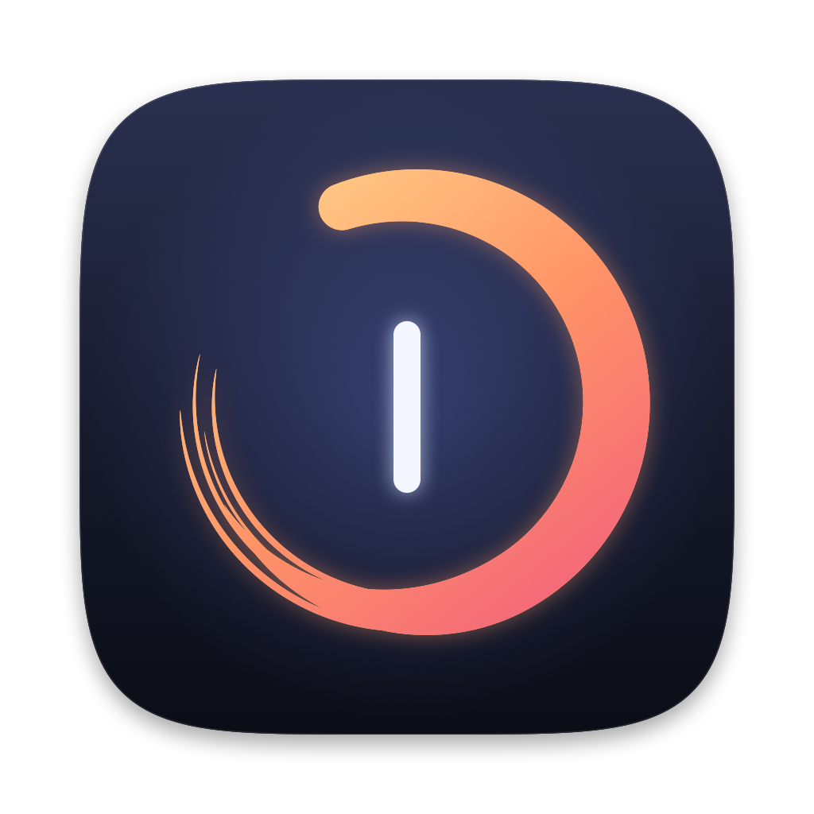

<p align="center">
  
</p>

<h1 align="center">Keno</h1>

<p align="center">
  A tiny, native macOS code editor: file explorer, tabbed editor, tabbed terminal.<br>
  Nothing else. Around 12&nbsp;MB of RAM.
</p>

---

*Keno* comes from the Greek **κενό**: "void, empty space". It keeps the editor layout you use every day (a folder tree on the left, tabs in the middle, terminals at the bottom or side) and drops everything else. It's pure Swift and AppKit: no Electron, no web views, no background services.

## Features

**Explorer**
- Folder tree that loads lazily and stays in sync with the disk (FSEvents)
- Single-click opens a preview tab; double-click keeps it open
- Context menu: new file/folder, rename, move to Trash, reveal in Finder, copy path, open in terminal

**Editor**
- Tabs with unsaved-change indicators, middle-click to close
- Syntax highlighting for Swift, C/C++/Obj-C, JS/TS, Python, Ruby, Go, Rust, Java/Kotlin, C#, PHP, Shell, JSON, YAML, TOML, HTML/XML, CSS, Markdown, SQL, Lua, Dockerfile and Makefile
- Incremental lexer: a keystroke re-lexes only until line states converge, and only visible lines are painted
- Line numbers, auto-indent, soft tabs, indent/outdent, toggle line comment, word wrap
- Find & replace bar
- **Format Document** using the formatter you already have installed (swift-format, prettier, ruff/black, gofmt, rustfmt, clang-format, shfmt, jq, xmllint, …)
- Image preview (PNG, JPEG, GIF, HEIC, WebP, AVIF, TIFF, …), decoded only at on-screen resolution
- Reloads files changed on disk when they have no unsaved edits

**Terminal**
- Multiple terminal tabs running your login shell, powered by [SwiftTerm](https://github.com/migueldeicaza/SwiftTerm)
- Panel can sit below or beside the editor
- Option stays Option, so international keyboard layouts can type `@ { } [ ] | \ ~`

**General**
- Remembers open tabs per folder, recent folders and layout
- Follows light/dark mode; one shared zoom level for the editor and terminal
- Multiple windows

## Keyboard shortcuts

| Action | Shortcut |
|---|---|
| Open file or folder | ⌘O |
| Open folder | ⇧⌘O |
| New file | ⌘N |
| Save / Save all | ⌘S / ⌥⌘S |
| Close tab | ⌘W |
| Toggle explorer | ⌘B |
| Toggle terminal | ⌃\` or ⌘J |
| New terminal | ⌃⇧\` |
| Next / previous tab | ⌃Tab / ⌃⇧Tab, ⌥⌘→ / ⌥⌘← |
| Find / Find & replace | ⌘F / ⌥⌘F |
| Toggle line comment | ⌘/ |
| Indent / outdent | ⌘] / ⌘[ (or Tab / ⇧Tab on a selection) |
| Format document | ⇧⌥F |
| Toggle word wrap | ⌥Z |
| Zoom in / out / reset | ⌘= / ⌘- / ⌘0 |

## Build

Requires macOS 13+ and Xcode (or the Swift toolchain).

```sh
./build.sh                          # builds build/Keno.app (release)
cp -R build/Keno.app /Applications/
```

Optional command-line launcher, like `code .`:

```sh
ln -s "$PWD/keno" /usr/local/bin/keno
keno .
```

The app icon is drawn in code; regenerate it with `swift Resources/make-icon.swift`.

## Design notes

- **TextKit 1** (`NSTextView` + `NSLayoutManager`) with non-contiguous layout, for predictable performance on large files.
- Syntax colors are layout-manager *temporary attributes*: they never touch the text storage or the undo stack.
- Each tab owns its own text view, so undo history, selection and scroll position are kept per tab.
- The terminal uses SwiftTerm's CoreGraphics renderer, not Metal, to stay light on older GPUs.
- Hidden panels are detached from the view hierarchy; their shells keep running.
